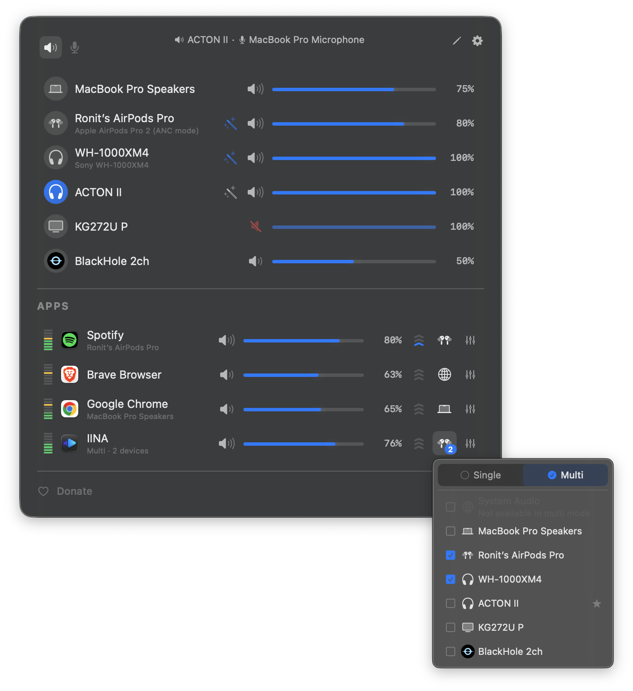
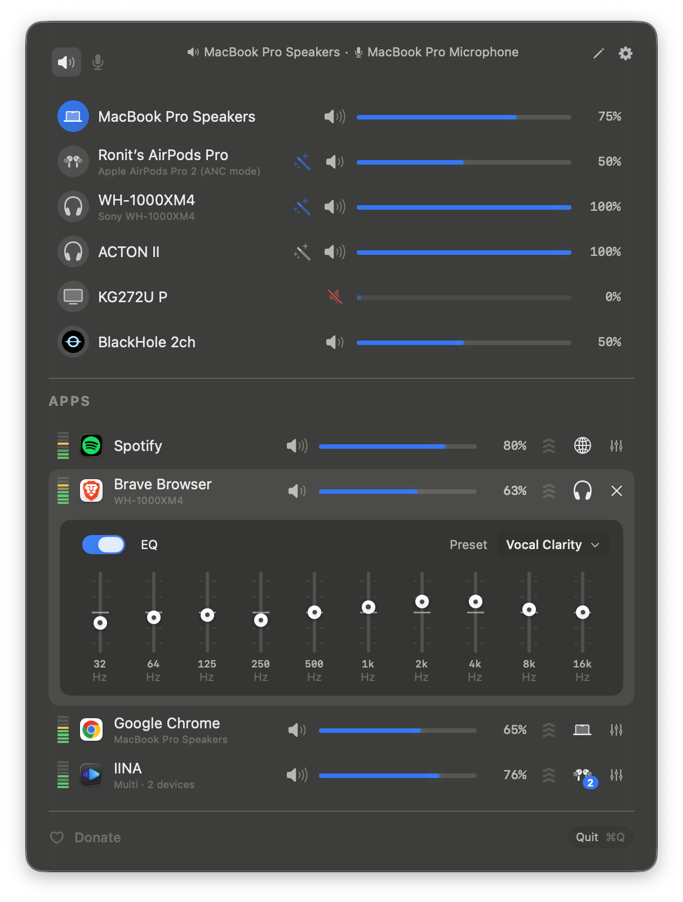

<h3>FineTune Fork</h3>

A maintained fork of [FineTune by Ronit Singh](https://github.com/ronitsingh10/FineTune): per-app volume, audio routing and EQ in your menu bar. This fork focuses on outputs without a volume control of their own, such as TVs and monitors connected over HDMI. On those, FineTune is the only volume control, so any sound that slips past it plays at full scale.

I'm grateful for Ronit's work. I needed my TV setup to keep working on macOS 27, so I'm maintaining this fork.

<a href="https://github.com/adschfr/FineTune/releases/latest/download/FineTune-Fork.dmg"></a>

<br clear="all"/>

<p align="center">
  <a href="https://github.com/adschfr/FineTune/releases/latest"></a>
  <a href="LICENSE"></a>
  <a href="https://ko-fi.com/adschfr"></a>
  <a href="https://www.apple.com/macos/"></a>
</p>

<p align="center">
  <strong>English</strong> · <a href="README.zh-CN.md">简体中文</a>
</p>

<p align="center">
  
</p>
<p align="center">
  
</p>

## Why this fork

The fork started with one problem: on a TV with software volume, a video that started after a pause played at full volume for a moment. The cause was audio that reached the output before FineTune processed it. The fork fixes that and the issues around it, and it merges upstream pull requests that were still open. It is based on FineTune v1.9.0 and keeps all of its features.

## What's different

- **No full-volume blast when playback starts.** Audio that starts before FineTune processes it is held back instead of playing unprocessed.
- **Your Mac can sleep while nothing plays.** Silent apps keep their tap, but it stops running after 10 seconds and starts again within milliseconds when the app plays.
- **New helper processes are covered.** A new browser tab or a sound played from Terminal joins the app's existing tap.
- **Safer on software-volume outputs.** No full volume after a display powers back on, and call passthrough stays off where an untapped call would play at full scale.
- **Over 20 upstream pull requests merged**, among them AirPlay selection, Bluetooth fixes, output format changes and the HUD over full-screen apps.
- **Tests for the audio lifecycle.** They run without touching your settings, permissions or the installed app.

The full list with issue numbers is in [FORK.md](FORK.md).

## Plans

- **Catch-all for TVs and monitors** (in development, off by default). It puts every app on a software-volume output under FineTune's volume, including apps that have no tap of their own yet, so no sound reaches the output unprocessed.
- **Own name and icon** once the catch-all ships, so the fork can no longer be mistaken for the original.
- **Keeping up with macOS.** The fork is developed and tested on macOS 27.2.
- **Ideas:** mute FineTune's outputs while you dictate, for example with MacWhisper.

## Install

1. Download [FineTune-Fork.dmg](https://github.com/adschfr/FineTune/releases/latest/download/FineTune-Fork.dmg), open it and drag **FineTune Fork** to Applications.
2. The app is not notarized by Apple, so macOS blocks the first launch. Open it once and click **Done**. Then open **System Settings → Privacy & Security**, scroll down and click **Open Anyway**. In Terminal, this does the same: `xattr -dr com.apple.quarantine "/Applications/FineTune Fork.app"`
3. Grant **Screen & System Audio Recording** when asked. The app is signed ad hoc, so macOS asks again after each update.
4. Click the FineTune icon in your menu bar. Apps playing audio appear automatically.

Good to know:

- FineTune Fork installs next to the original FineTune and shares its settings. **Run only one of the two at a time.**
- There are no automatic updates. To hear about new versions, watch the repository for releases (**Watch → Custom → Releases**).
- The Homebrew cask `finetune` installs the original, not this fork.

### Build from source

```bash
git clone https://github.com/adschfr/FineTune.git
cd FineTune
./scripts/install-fork.sh
```

This needs Xcode. It builds a Release, installs it as `/Applications/FineTune Fork.app` and launches it. [FORK.md](FORK.md) explains signing and the test script.

> **Tip:** Want FineTune to auto-switch to a specific device when you connect it? Open edit mode (pencil icon) and drag it above the built-in speakers. This is a one-time setup. Your preferred order is saved permanently.

## Features

### 🎚 Volume Control
- **Per-app volume** — Individual sliders and mute for each application
- **Per-app volume boost** — 2x / 3x / 4x gain presets
- **Pinned apps** — Keep apps visible in the menu bar even when they're not playing, so you can configure volume, EQ, and routing in advance
- **Ignore apps** — Completely disengage FineTune from specific apps. Tears down the audio tap so the app returns to normal macOS audio
- **Scroll-wheel volume** — Hover any slider in the popup, the HUD, or the EQ panel and scroll to adjust.

### ⌨️ Keyboard
- **Global volume hotkeys** — Bind your own keys to **App Volume Up**, **App Volume Down**, and **App Mute** from Settings → Shortcuts. The "app" is whichever is currently making sound, so volume-down while a YouTube tab plays behind a foreground Terminal turns down YouTube, not the terminal. If nothing is audible, the hotkey falls through to the frontmost app.
- **Toggle the popup from anywhere** — Bind a hotkey to **Toggle FineTune Popup** and the menu bar opens or closes on demand, including from full-screen apps.
- **Configurable step size** — Pick **Coarse / Normal / Fine / Extra-Fine** under Settings → Shortcuts → Volume Step. The same setting governs the F10–F12 media keys, the global hotkeys, and the popup's arrow-key navigation.
- **Hold to ramp, auto-unmute on volume-up** — Holding App Volume Up or Down emits repeats the way macOS does for arrow keys. Volume-up while muted unmutes and sets the new level in one keystroke.
- **Drive the popup with the keyboard** — Once the popup is open, **↑ / ↓** move between rows, **← / →** adjusts the focused row's volume (Shift = 2× step), **M** toggles mute, **Return / Space** activates, **Tab** switches between Output and Input device tabs, **Esc** closes. The focused row autoscrolls to center as you arrow through.

### 🔀 Audio Routing
- **Multi-device output** — Route audio to multiple devices simultaneously
- **Audio routing** — Send apps to different outputs or follow system default
- **Device priority** — Choose which device FineTune switches to when a new device connects; auto-fallback on disconnect
- **Auto-restore** — When a device reconnects, apps automatically return to it with their volume, routing, and EQ intact

### 🎛 EQ & Correction
- **10-band EQ** — 20 presets across 5 categories
- **User EQ presets** — Save, rename, and manage custom EQ configurations per app
- **AutoEQ headphone correction** — Search thousands of headphone profiles or import your own ParametricEQ.txt files for per-device frequency response correction
- **Loudness compensation** — Automatic bass and treble correction at low volumes using ISO 226:2023 equal-loudness contours, with real-time level management to keep perceived loudness consistent

### 🖥 Devices & System
- **Input device control** — Monitor and adjust microphone levels
- **Alert volume** — Control macOS notification and alert volume from settings
- **Smart volume backend** — FineTune auto-picks hardware, DDC, or software volume per device. If the hardware slider on a USB DAC or HDMI output doesn't actually control level, force software volume from the device inspector and FineTune remembers the choice for that device
- **Device inspector** — Tap the info button on any device row for sample rate (with picker), transport, UID copy, hog-mode banner, and the software-volume override
- **Hide devices** — Eye toggle in edit mode hides output and input devices you don't want in the list, mirroring the app-hide flow
- **Bluetooth device management** — Connect paired devices directly from the menu bar
- **Monitor speaker control** — Adjust volume on external displays via DDC
* **Media keys and Volume HUD:** Opt in F10 through F12 control for the default output device, with an optional Tahoe or Classic onscreen HUD. Turn the HUD off when another app already displays volume changes. The write goes through FineTune's volume pipeline, so keys keep working on USB interfaces and HDMI outputs where macOS's own keys are greyed out because the hardware slider is broken.
- **Dynamic menu bar icon** — Pick from four styles in Settings (Default, Speaker, Waveform, Equalizer). The **Speaker** style tracks volume live (zero / low / mid / high glyphs) and switches to a slashed speaker when muted. All styles briefly flash the new output's SF Symbol on device switch. Changing style applies instantly, no relaunch required.
- **Menu bar app** — Lightweight, always accessible
- **URL schemes** — Automate volume, mute, device routing, and more from scripts

### 🎨 Appearance
- **Light or Dark theme** — Settings → General → Theme matches macOS or locks FineTune to Light or Dark. The menu bar popup, every popover, and the volume HUD switch immediately.
- **Popup density** — Settings → General → Popup Size picks **Compact / Comfortable / Spacious** with a live tile preview. Compact fits more apps on small screens; Spacious gives bigger hit areas for trackpads.

## Documentation

- **[AutoEQ & Headphone Correction](guide/autoeq.md)** — Apply frequency correction from the [AutoEQ](https://github.com/jaakkopasanen/AutoEq) project, import [EqualizerAPO](https://sourceforge.net/projects/equalizerapo/) profiles, or browse [autoeq.app](https://www.autoeq.app/)
- **[URL Schemes](guide/url-schemes.md)** — Automate FineTune from Terminal, [Shortcuts](https://support.apple.com/guide/shortcuts-mac), [Raycast](https://raycast.com), or scripts
- **[Troubleshooting](guide/troubleshooting.md)** — Permission issues, missing apps, audio problems

## Contributing

- **Report a bug:** [open an issue](https://github.com/adschfr/FineTune/issues). For audio problems, include your macOS version, the output device (for example "TV over HDMI") and which apps were playing.
- **Contribute code:** see [CONTRIBUTING.md](CONTRIBUTING.md).

## Requirements

- macOS 15.4 (Sequoia) or later, Apple silicon or Intel
- Screen & System Audio Recording permission (asked on first launch)

## Support

FineTune was created by [Ronit Singh](https://github.com/ronitsingh10/FineTune). This fork builds on his work and is maintained by [adschfr](https://github.com/adschfr). It stays free and open source. If the fork made your day a little easier, you can support its maintenance on Ko-fi. Not expected, but appreciated.

[](https://ko-fi.com/adschfr)


## License

[GPL v3](LICENSE). FineTune © 2026 Ronit Singh. Changes in this fork © 2026 adschfr.
